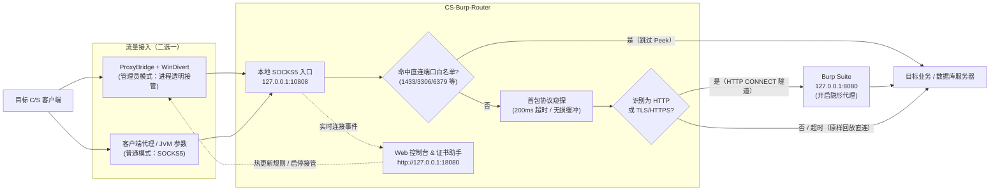

<p>
  
</p>

# CS-Burp-Router

面向 Windows 的 C/S 客户端流量智能分流工具。将 HTTP 和 HTTPS 流量自动转发到 Burp Suite，数据库及其他非 HTTP TCP 流量默认直连，并在本地 Web 控制台实时展示连接状态与分流结果，解决 C/S 厚客户端抓包时常见的数据库连接阻塞与超时问题。

## 界面预览


> 内置轻量级 Web 控制台（默认 `http://127.0.0.1:18080`），支持进程一键接管、连接实时筛选与搜索、Burp 地址与直连端口热更新、Burp CA 证书管理、深浅色主题切换及 ProxyBridge 引擎日志查看。

## 核心特性

- **协议智能分流**：对入站连接执行 200ms 短超时首包窥探（无损缓冲前 8 字节），自动识别 HTTP 明文方法与 TLS ClientHello（`0x16 0x03`）并送入 Burp Suite，其余未知 TCP 协议原样回放字节并直连放行。
- **数据库端口快车道**：命中直连端口白名单（默认 `21, 22, 25, 1433, 1521, 3306, 5432, 6379, 27017`）时直接跳过协议窥探立即直连，避免 MySQL / MSSQL / Redis 等 Server-Speaks-First 协议握手死锁。
- **Windows 一键进程接管**：集成 ProxyBridge 与 WinDivert，以管理员身份运行即可按进程名、应用名或窗口标题选中目标客户端进程进行透明接管；普通用户权限下可无缝降级为本地 SOCKS5 代理模式。
- **Burp CA 证书助手**：支持从 Burp 自动拉取 CA 证书、展示 SHA-256 指纹供核对、一键导入 Windows 信任库以及测试结束后的卸载清理。
- **安全与零依赖**：仅绑定回环地址，每次启动随机生成控制台访问凭据；单一 Go 可执行文件，前端静态资源通过 `embed` 内嵌。

## 工作原理与架构



## Burp Suite 隐形代理配置

> **为什么必须开启隐形代理？**
> C/S 厚客户端通常直接连接目标服务器 IP/域名，发出的是相对路径请求或原生 TLS 握手，而非传统浏览器的显式代理请求。CS-Burp-Router 将识别出的 HTTP/HTTPS 流量通过 `CONNECT` 隧道转发给 Burp Suite 后，**必须开启隐形代理（Invisible Proxying）**，Burp 才能正确解析并转发此类流量。

### 配置步骤

1. 打开 Burp Suite，进入 **Proxy** → **Proxy settings** → **Proxy listeners**。
2. 选中 `127.0.0.1:8080` 监听器（如不存在请点击 **Add** 新建），点击 **Edit**。
3. 切换到 **Request handling** 标签页。
4. 勾选 **Support invisible proxying (enable only if needed)**，点击 **OK** 保存生效。

```text
Burp Suite
 └─ Proxy
     └─ Proxy settings
         └─ Proxy listeners
             └─ Edit (127.0.0.1:8080)
                 └─ Request handling
                     └─ [✓] Support invisible proxying (enable only if needed)
```

### HTTPS 抓包与常见排查

- **安装 Burp CA 证书**：在控制台点击顶部 **安装证书**（或 **路由设置** → **一键安装证书**），核对页面展示的 **SHA-256 指纹** 与 Burp 导出的 CA 证书一致后再确认安装。控制台会展示 Windows 当前生效的信任状态，测试结束后可点击 **卸载清理**。
- **抓不到包时请检查**：
  1. 确认 Burp 监听地址与控制台 **路由设置** 中的 Burp 地址一致（默认 `127.0.0.1:8080`）。
  2. 确认顶部模式处于 **智能分流**（而非 **全局直连**）。
  3. 若目标客户端直连内网裸 IP 且未触发接管，可在 **路由设置** 中将 **ProxyBridge 域名匹配策略** 切换为 **纯 IP 适配 (`""`)** 后重新启动接管。

## 快速开始

### 方式一：管理员模式一键进程接管（推荐）

1. 按上方说明完成 Burp Suite 隐形代理配置。
2. 解压便携包，右键 `cs-burp-router.exe` 选择 **以管理员身份运行**。默认浏览器会自动打开本地控制台（`http://127.0.0.1:18080`）。
3. 在控制台点击 **选择运行进程**，按进程名、应用名或窗口标题搜索并勾选目标客户端（如 `client.exe`、`javaw.exe`），点击 **启动接管**。
4. 如需调试 HTTPS，在控制台点击 **安装证书** 并核对指纹后完成导入。

### 方式二：普通用户 SOCKS5 模式（无需管理员权限）

1. 直接双击或命令行运行 `cs-burp-router.exe`。
2. 无需启用进程接管，将目标客户端代理或 JVM 启动参数指向 `127.0.0.1:10808`，例如：
   ```text
   -DsocksProxyHost=127.0.0.1 -DsocksProxyPort=10808
   ```
3. HTTP / HTTPS 流量将自动进入 Burp Suite，数据库及其他 TCP 流量自动直连。

### 终端快捷操作

- 在程序运行的交互式终端按 `Enter` 可重新在浏览器打开控制台。
- 输入 `link` 后按 `Enter` 可查看本次启动带访问凭据的完整链接。
- 启动时传入 `-no-browser` 可禁止自动拉起浏览器，并直接在终端输出完整链接。

## 命令行参数

| 参数 | 默认值 | 说明 |
| --- | --- | --- |
| `-listen` | `127.0.0.1:10808` | 本地 SOCKS5 回环监听地址 |
| `-burp` | `127.0.0.1:8080` | 上游 Burp Suite 代理地址（支持在控制台热更新） |
| `-web` | `127.0.0.1:18080` | 本地 Web 控制台回环监听地址 |
| `-bridge-bin` | 自动探测 | 自定义 `ProxyBridge_CLI.exe` 路径 |
| `-no-browser` | `false` | 不自动打开浏览器，在终端输出完整控制台链接 |

更多现场操作说明见 [使用说明](packaging/使用说明.txt)。

## 从源码构建

在 Windows x64 上准备 Go 1.27.0 或更高版本和 GCC，并启用 CGO。在仓库根目录运行：

```powershell
.\scripts\build.ps1
```

脚本会自动生成嵌入式 Windows PE 资源、执行 `go vet` 和 `go test -race`，并打包生成便携包 `dist/cs-burp-router-windows-amd64.zip`。

## 第三方组件与许可协议

- 本项目源代码基于 [MIT License](LICENSE) 开源。
- 便携包内包含以下第三方组件（保留其各自原始许可证）：
  - [ProxyBridge 4.3.0 Windows](https://github.com/InterceptSuite/ProxyBridge/releases/tag/v4.3.0_Windows)（MIT）
  - [WinDivert 2.2.2-A x64](https://github.com/basil00/WinDivert/releases/tag/v2.2.2)（LGPLv3 / GPLv2，[对应源码](https://www.reqrypt.org/download/WinDivert-2.2.2-Source.zip)）
