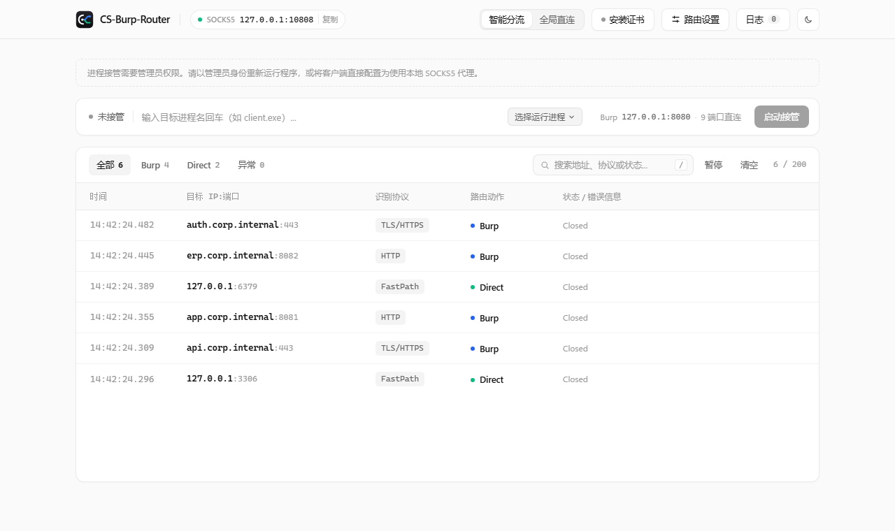
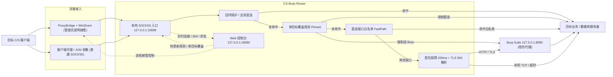

<div align="center">
  
  <h1>CS-Burp-Router</h1>
  <p><strong>专为 Windows C/S 客户端打造的智能抓包分流器</strong></p>
  <p>HTTP / HTTPS 自动送入 Burp Suite，数据库与非 HTTP 流量自动直连放行，彻底告别抓包卡死与超时。</p>

  <p>
    
    
    
    <a href="LICENSE"></a>
  </p>

  <p>
    <a href="#quickstart">3 分钟上手</a> ·
    <a href="#scenarios">场景教学</a> ·
    <a href="#troubleshooting">10 秒排障</a> ·
    <a href="#advanced">进阶与原理</a>
  </p>
</div>

<br />

<div align="center">
  
  <p><sub>内置本地 Web 控制台（<code>http://127.0.0.1:18080</code>）：选进程、看域名、点覆盖、管证书一站完成</sub></p>
</div>

---

## 为什么需要它？

用传统全局代理抓桌面客户端（C/S 架构）时，往往会遇到以下痛点：

| 传统抓包痛点 | CS-Burp-Router 的解法 |
| --- | --- |
| **一挂代理就卡死/超时**：客户端连数据库（MySQL / MSSQL / Oracle / Redis）也被拦进 Burp | **自动智能分流**：网页与接口流量送入 Burp，数据库与未知 TCP 流量自动直连放行 |
| **不知道该抓哪个进程**：启动器拉起一堆子进程，挨个试非常耗时 | **活跃外联置顶**：自动按外联连接数排序，一键勾选「仅看活跃外联进程」或按目标 IP 反查 |
| **满屏内网裸 IP 分不清业务**：直连 `10.x.x.x:443` 看不出域名，老客户端握手莫名失败 | **SNI 与弱加密透视**：自动识别 TLS 真实域名（SNI）与版本，`TLS 1.0/1.1` 橙色预警 |
| **个别地址想放行或强抓**：为了一个特例去改全局规则容易误伤 | **单目标一键覆盖**：连接表最右侧一键「强制直连」或「强制进 Burp」，即点即生效 |
| **装证书麻烦、撤场怕残留**：手动导出导入系统根证书繁琐 | **Burp 证书助手**：核对指纹一键导入系统信任库，测试结束一键卸载清理 |

---

<a id="quickstart"></a>

## 3 分钟快速上手

### 第 1 步：在 Burp Suite 打开「隐形代理」

> [!IMPORTANT]
> **这一步必须做。** 桌面客户端不像浏览器那样发送标准代理请求，如果不勾选隐形代理，流量进了 Burp 也会报错或抓不到包。

打开 Burp Suite，按以下路径勾选并保存：

```text
Proxy
 └─ Proxy settings
     └─ Proxy listeners
         └─ 选中 127.0.0.1:8080 → 点击 Edit
             └─ Request handling
                 └─ [✓] Support invisible proxying (enable only if needed)
```

---

### 第 2 步：启动 CS-Burp-Router

解压便携包后，**右键 `cs-burp-router.exe` → 选择「以管理员身份运行」**。

启动后会自动弹出浏览器打开本地控制台（`http://127.0.0.1:18080`）。

> [!TIP]
> 没有管理员权限也能用！直接双击运行即可降级为本地 SOCKS5 代理模式（`127.0.0.1:10808`），详见下方「进阶用法」。

---

### 第 3 步：选出正在发包的进程，开始接管

1. 先在目标桌面客户端里点一下登录或任意功能（让它产生一次联网）。
2. 在控制台点击 **「选择运行进程」**，勾选工具栏中的 **「仅看活跃外联进程」**。
3. 正在对外联网的进程会自动排在最前面（带蓝色连接数徽标，例如 `(5)` 和目标地址预览 `→ 10.20.30.40:443`），勾选目标进程。
4. 点击右侧 **「启动接管」**。

此时操作目标客户端，HTTP / HTTPS 请求就会自动出现在 Burp Suite 的 **Proxy → HTTP history** 中，数据库流量则保持直连不卡顿。

---

### 第 4 步：需要抓 HTTPS 时，一键安装 Burp 证书

1. 确保 Burp Suite 已经启动，点击控制台顶部 **「安装证书」**（或在 **「路由设置」** 中点击 **「一键安装证书」**）。
2. 弹窗会显示当前 Burp 根证书的 **SHA-256 指纹**，核对无误后点击确认导入。
3. 如果客户端自带独立证书库（如部分 Java 客户端），可点击 **「下载 .der」** 手动导入。

> [!TIP]
> 测试结束后，点击控制栏 **「停止」** 结束接管，再到 **「路由设置」→「Burp CA 根证书」→「卸载清理」**，即可一键把根证书从系统移除。

---

<a id="scenarios"></a>

## 日常抓包场景教学

不用记原理，**遇到什么情况，直接照着下面点就行**：

### 场景 1：客户端有很多子进程，不知道真正发包的是哪一个
1. 在客户端触发一次网络操作，打开控制台 **「选择运行进程」**。
2. 勾选 **「仅看活跃外联进程」**，排在最前且带 `(连接数)` 的进程就是正在联网的进程。
3. 也可以在弹窗搜索框直接输入**业务服务器 IP 或端口**反查对应进程；如果是短连接，边点客户端边点弹窗右上角 **「刷新」**。

### 场景 2：某个连接一直卡顿，或不想让它经过 Burp
在实时连接表中找到这一行，点击最右侧操作列的 **「强制直连」**。
- 生效后该目标会直接跳过 200ms 协议探测、毫秒级直连，路由动作列会显示 **`覆盖`** 徽标。
- 随时可在行内点击 **「取消覆盖」**，或在 **「路由设置」→「当前覆盖规则」** 中统一查看与 **「清空全部」**。

### 场景 3：HTTP/HTTPS 跑在 3306 / 1433 等数据库端口，被默认放行了
不需要把端口从全局白名单删掉（否则会影响真正的数据库）。直接在连接表找到该行，点击操作列的 **「强制进 Burp」**，即可只针对这一个目标突破端口白名单、送进 Burp。

### 场景 4：内网全是裸 IP 分不清接口，或老旧客户端 HTTPS 报错
- **看真实域名**：纯 IP 建连但带 TLS 域名（SNI）时，**「目标地址 / SNI」** 列主行会高亮显示域名 + `SNI` 标签（点主行复制域名，点次行复制 `IP:端口`）。
- **定位老客户端握手失败**：如果 **「识别协议」** 列出现橙色标签 **`TLS 1.0 (弱加密)`** 或 **`TLS 1.1 (弱加密)`**，说明客户端只支持旧版加密协议；前往 Burp 的 **Settings → Network → TLS** 勾选启用对应的旧版 TLS 协议即可恢复抓包。

### 场景 5：客户端报错，不确定是不是抓包导致的
点击控制台顶部 **「全局直连」**，所有新建连接会立刻绕过 Burp（优先级高于单目标覆盖规则）。
- 切换后如果业务恢复正常，说明问题出在 Burp 侧（通常是没勾隐形代理、没装证书或旧版 TLS 未启用）；
- 排查完毕点击 **「恢复智能分流」** 即可继续抓包。

> [!NOTE]
> **效率快捷键**：在主页面按 `/` 快速聚焦搜索框，可直接输入 `IP`、`域名/SNI`、`协议`、`弱加密`、`覆盖` 或错误信息筛选记录；按 `Esc` 快速关闭弹窗或侧边抽屉。

---

<a id="troubleshooting"></a>

## 遇到问题？10 秒对照排障

| 你看到的现象 | 常见原因 | 怎么解决 |
| --- | --- | --- |
| 连接表显示 `Burp`，但 Burp 里没包或报错 | Burp 未开隐形代理，或端口不一致 | 按「第 1 步」勾选 **Support invisible proxying**；检查「路由设置」里的 Burp 地址是否与 Burp 一致 |
| 点了「启动接管」，但连接表一直是空的 | 选错了子进程，或纯内网 IP 未命中规则 | 打开进程选择器勾选 **「仅看活跃外联进程」** 确认真实发包进程；若目标为内网纯 IP，在「路由设置」将匹配策略切换为 **纯 IP 适配 (`""`)** 后点击 **「更新重启」** |
| 客户端提示证书错误 / HTTPS 连不上 | 未安装 Burp CA，或客户端为旧版 TLS | 点顶部 **「安装证书」** 导入系统信任库；若协议列出现橙色 **弱加密** 标签，在 Burp 开启 TLS 1.0/1.1 |
| 客户端连非标准端口数据库/私有协议卡顿 | 命中了 200ms 协议窥探 | 在连接表该行点 **「强制直连」**，或在「路由设置」把该端口加入 **直连白名单端口** |
| 不小心把控制台浏览器关了 | 控制台带每次启动随机生成的凭据 | 切回程序黑色终端窗口，按一下 `Enter` 自动重新打开；输入 `link` 回车可查看完整链接 |
| 「启动接管」按钮是灰色的 | 未以管理员身份运行 | 右键 `cs-burp-router.exe` 选择 **以管理员身份运行**，或改用下方「普通用户 SOCKS5 模式」 |

---

<a id="advanced"></a>

## 进阶用法与工作原理

<details>
<summary><strong>1. 无管理员权限：普通用户 SOCKS5 模式</strong></summary>

1. 直接双击或命令行运行 `cs-burp-router.exe`（无需管理员权限，无需启动进程接管）。
2. 将目标客户端的代理设置指向本地 SOCKS5 地址 `127.0.0.1:10808`，例如 Java 客户端启动参数：
   ```text
   -DsocksProxyHost=127.0.0.1 -DsocksProxyPort=10808
   ```
3. 经过该端口的 HTTP / HTTPS 流量自动进入 Burp，数据库与其他 TCP 流量自动直连，Web 控制台的 SNI 展示、弱加密提示、单目标覆盖等功能同样完整可用。

</details>

<details>
<summary><strong>2. 命令行参数与默认端口</strong></summary>

| 参数 | 默认值 | 说明 |
| --- | --- | --- |
| `-listen` | `127.0.0.1:10808` | 本地 SOCKS5 回环监听地址 |
| `-burp` | `127.0.0.1:8080` | 上游 Burp Suite 代理地址（可在控制台热更新） |
| `-web` | `127.0.0.1:18080` | 本地 Web 控制台回环监听地址 |
| `-bridge-bin` | 自动探测 | 自定义 `ProxyBridge_CLI.exe` 路径 |
| `-no-browser` | `false` | 不自动拉起浏览器，直接在终端打印带访问凭据的完整链接 |

**默认直连端口白名单**：`21 (FTP)`, `22 (SSH)`, `25 (SMTP)`, `1433 (MSSQL)`, `1521 (Oracle)`, `3306 (MySQL)`, `5432 (PostgreSQL)`, `6379 (Redis)`, `27017 (MongoDB)`。

</details>

<details>
<summary><strong>3. 路由优先级与架构流程图</strong></summary>

每条入站连接严格按照以下优先级执行（高优先级覆盖低优先级）：

1. **回环保护**：拒绝连接自身 SOCKS5 监听端口，直连放行发往 Burp 与 Web 控制台的流量。
2. **全局直连 (`BypassAll`)**：开启后所有新建连接立即直连。
3. **单目标覆盖 (`Pinned`)**：按 `精确 host:port > host` 匹配，立即执行强制直连或强制进 Burp。
4. **直连端口白名单 (`FastPath`)**：跳过首包窥探，避免 Server-Speaks-First 协议握手阻塞。
5. **首包协议窥探 (`Peek`)**：200ms 短超时无损读取前 8 字节识别 HTTP / TLS（命中 TLS 时额外最多 100ms 补读完整 ClientHello 解析 SNI 与版本，上限 4096 字节），其余协议原样回放字节直连。



</details>

<details>
<summary><strong>4. 从源码编译打包</strong></summary>

在 Windows x64 上准备 Go 1.27.0+ 和 GCC（启用 CGO 以运行 `-race` 测试），在仓库根目录执行：

```powershell
.\scripts\build.ps1
```

脚本会自动生成嵌入式 Windows PE 资源、执行 `go vet` 与 `go test -race`，并打包便携包到 `dist/cs-burp-router-windows-amd64.zip`。

</details>

> 随便携包附带的精简版现场速查单见 [packaging/使用说明.txt](packaging/使用说明.txt)。

---

## 开源协议与第三方组件

- 本项目源代码基于 [MIT License](LICENSE) 开源。
- 便携包内包含以下第三方组件（保留各自原始许可证）：
  - [ProxyBridge 4.3.0 Windows](https://github.com/InterceptSuite/ProxyBridge/releases/tag/v4.3.0_Windows)（MIT）
  - [WinDivert 2.2.2-A x64](https://github.com/basil00/WinDivert/releases/tag/v2.2.2)（LGPLv3 / GPLv2，[对应源码](https://www.reqrypt.org/download/WinDivert-2.2.2-Source.zip)）
